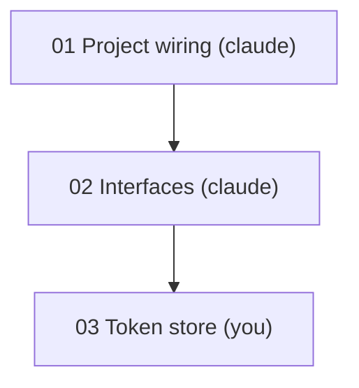

# Obsidian conventions

Everything this skill writes must work in Obsidian with **core features only**, and stay readable as plain markdown anywhere else. No Dataview, Templater, or other plugin syntax, so the files stay portable.

## Contents
- Vault root and links
- Properties (YAML)
- Callouts
- Mermaid
- Checkboxes
- Filenames
- Renames

## Vault root and links

The vault root is `prd_root` (the `prd/` directory). All wikilinks are **path-qualified from the vault root** and carry a display alias, so identically named files in different tasks never collide:

```
[[my-repo/auth-rework/03.02-token-store|03 Token store]]
```

Rules:
- Omit the `.md` extension.
- Always include the repo and task folders in the path.
- Always include an alias after `|` in the form `NN Name`, matching the PRD table.
- Dots in numbered filenames (`04.02-slug`) are fine; Obsidian appends `.md`.
- Inside markdown tables, escape the pipe as `\|` in the wikilink alias.
- Do not use embeds (`![[...]]`).

Cross-reference generously: the PRD links to every walkthrough, every walkthrough links up to the PRD and across to its `depends_on` and `blocks`. This gives the user working backlinks and graph view for free.

## Properties (YAML)

Front matter on every file. Required keys:

| Key | PRD | Walkthrough |
|---|---|---|
| `type` | `prd` | `walkthrough` |
| `repo` | yes | yes |
| `task` | yes | yes |
| `status` | `planning` / `in-progress` / `done` / `dropped` | `not-started` / `in-progress` / `blocked` / `done` / `dropped` |
| `tags` | list | list |
| `settings` | yes | no |
| `prd`, `created`, `updated` | yes | no |
| `id`, `name`, `owner` | no | yes |
| `depends_on`, `blocks`, `up` | no | yes |

Gotchas:
- **Links in YAML must be quoted**: `"[[my-repo/task/02-x|02 X]]"`. Unquoted `[[...]]` parses as a nested list.
- `depends_on` and `blocks` are lists of quoted wikilinks (use `[]` when empty).
- `tags` is a list without the `#` prefix. Use `owner/you` or `owner/claude` for nested tags.
- Dates are `YYYY-MM-DD`.

## Callouts

Use standard callout syntax.

| Purpose | Syntax |
|---|---|
| Next up and resume markers | `> [!info] Next up` and `> [!info] Resume here` |
| Open questions | `> [!question] Q1: ...` |
| Hints (always folded) | `> [!hint]- Hint 1: nudge` |
| Reference solution (folded) | `> [!success]- Reference solution` |
| Resolved open question | change to `> [!success]- Q1 (resolved): ...` and add the answer |
| Warnings about drift or blocks | `> [!warning] ...` |

The `-` after the type makes a callout collapsed by default. Hints must always be collapsed so the user does not spoil them.

Number open questions (Q1, Q2, ...) within each file so they can be referenced in conversation.

## Mermaid

The dependency tree in the PRD is a Mermaid block, which Obsidian renders natively:

````markdown

````

Node labels are `NN Name (owner)`, matching the table. Wikilinks do not render inside Mermaid, so the table beside it carries the links. Quote node labels so spaces and parentheses are safe.

## Checkboxes

Steps are standard task-list items: `- [ ]` and `- [x]`. Tick a box only after the step is verified done. Never use plugin-specific checkbox states.

## Filenames

- Lowercase kebab-case ASCII.
- No characters Obsidian treats specially in links: `# ^ [ ] |`.
- Numbered prefix, optional dependency numbers, then a short slug: `NN-slug.md`, `NN.MM-slug.md`, `NN.MM.KK-slug.md`.
- PRD file: `prd-<prd-name>.md`.

## Renames

If a task's dependencies change, its filename changes (`04.02-x.md` becomes `04.02.03-x.md`). Rename the file, then update every wikilink that points at it (PRD table, other walkthroughs' `depends_on`, `blocks`, and `up`). Obsidian only auto-updates links when the rename happens inside the app, so Claude must do this explicitly. Search the task directory for the old path to catch every reference. `scripts/rename_task_file.py` does all of this in one step.
