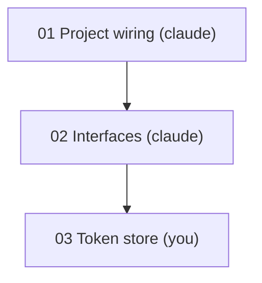

# PRD template

File: `prd_root/<repo>/<task-name>/prd-<prd-name>.md`. `<prd-name>` is a short kebab-case slug, usually the same as the task name.

The PRD is the **single source of truth**. It holds the plan, the task table (the high-level task list), the dependency tree, and task-level status. Walkthroughs hold the implementation detail and step-level progress.

Use today's date for `created` and `updated`. Update `updated` and the status columns whenever they change.

## Contents
- Template
- Filling it in
- Rules

## Template

````markdown
---
type: prd
repo: <repo>
task: <task-name>
prd: <prd-name>
status: planning        # planning | in-progress | done | dropped
created: YYYY-MM-DD
updated: YYYY-MM-DD
settings:
  grill: full
  own: core
  hints: graduated
  stop: scaffold
  level: familiar
tags:
  - prd
  - step-by-step
---

# <Human-readable title>

> [!info] Next up
> [[<repo>/<task-name>/03.02-token-store|03 Token store]], step 1. Owner: you.

## Tasks

| # | Task | Owner | Depends on | Status | Walkthrough | Notes |
|---|------|-------|------------|--------|-------------|-------|
| 01 | Project wiring | claude | none | done | n/a | Config and CI hooks only |
| 02 | Interfaces | claude | 01 | done | [[<repo>/<task-name>/02.01-interfaces\|02 Interfaces]] | Stubs live in the shared module |
| 03 | Token store | you | 02 | not-started | [[<repo>/<task-name>/03.02-token-store\|03 Token store]] | Core logic, owned by you |

### Dependency tree



## Problem Statement

The problem the user is facing, from the user's perspective.

## Solution

The solution, from the user's perspective.

## User Stories

A long, numbered list covering all aspects of the feature, each in the form:

1. As an <actor>, I want <feature>, so that <benefit>

## Implementation Decisions

- Modules to build or modify
- Interfaces of those modules
- Technical clarifications from the user
- Architectural decisions
- Schema changes
- API contracts
- Specific interactions

Do not include file paths or code snippets; they go stale quickly. Exception: if a prototype produced a snippet that encodes a decision more precisely than prose can (a state machine, reducer, schema, or type shape), inline the decision-rich part and note briefly that it came from a prototype.

## Testing Decisions

- What makes a good test here (test external behavior, not implementation details)
- The test seams agreed with the user (prefer existing seams; use the highest seam possible)
- Which modules are tested
- The command that runs the tests for each area (backend, frontend, and so on), so every stage can point the user at it
- Prior art for the tests in the codebase

## Assumptions and Open Questions

> [!question] Q1: <PRD-level question that affects scope>
> Context and options.

List assumptions made during `grill=quick` or `grill=skip` here. Task-level open questions live in the walkthroughs.

## Out of Scope

What this PRD deliberately does not cover.

## Further Notes

Anything else worth recording.

## Change Log

- YYYY-MM-DD: Created. Settings: grill=full, own=core, hints=graduated, stop=scaffold, level=familiar.
````

## Filling it in

- **Task IDs** are two-digit, assigned in dependency order so prerequisites get lower numbers where possible. The ID is the first number in the walkthrough filename.
- **Owner** is `claude` or `you`, as approved in the split step.
- **Depends on** lists direct prerequisites by ID. It must match the walkthrough filename and its `depends_on` front matter.
- **Status** is one of `not-started`, `in-progress`, `blocked`, `done`, `dropped`. For `blocked`, say why in Notes.
- **Walkthrough** links to the file if the task would be painful to resume cold; otherwise `n/a`, with the needed context in Notes (and a `TODO(you)` stub in the code for user-owned tasks).
- **Next up** callout at the top always names the first unfinished user-owned task and step, so a fresh instance sees it immediately. While that task's prerequisites are unfinished, start the line with "After Claude's scaffolding:".
- The Mermaid node labels use the same number and name as the table rows and wikilink aliases. Wikilinks do not render inside Mermaid, so the table carries the links.
- Note the settings that were chosen, even the defaults, so a future instance knows how the work was meant to run.
- `scripts/new_task.py` generates the table, the Mermaid tree (nodes first, then edges), and the Next up callout from a task list, so those parts are never hand-assembled.

## Rules

- Never silently change scope. Edits that change tasks, owners, or dependencies are proposed to the user first, then logged in the Change Log.
- After a PRD change, run the drift check and regenerate affected walkthroughs (see `resume-and-regeneration.md`).
- Do not put step-by-step detail in the PRD. That belongs in walkthroughs.
